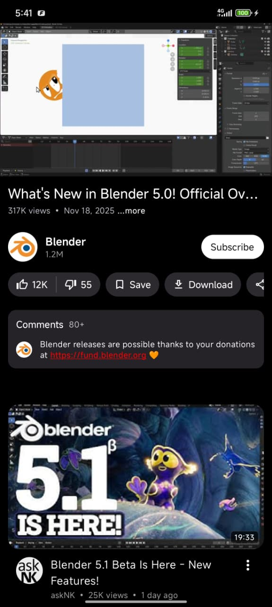
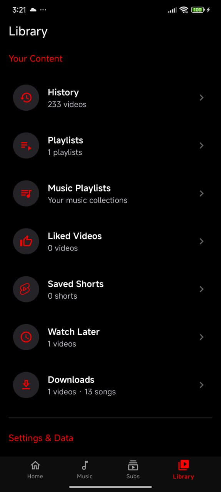

<div align="center">
  

  <h1>Flow Tube</h1>

  <h3>A privacy-first YouTube and YouTube Music client for Android, with recommendations that never leave your phone.</h3>

  <p>
    <a href="https://github.com/mrvoidxin/Flow-tub/releases/latest"></a>
    <a href="License"></a>
    
    
  </p>

  <p>
    <a href="https://github.com/mrvoidxin/Flow-tub/releases"><b>Download APK</b></a> ·
    <a href="#build-from-source"><b>Build</b></a> ·
    <a href="privacy.md"><b>Privacy</b></a> ·
    <a href="CONTRIBUTING.md"><b>Contribute</b></a>
  </p>
</div>

---

## Why Flow Tube?

Most open-source YouTube clients give you playback but no way to discover new content. You either use the official app and get tracked, or you use an alternative and lose recommendations entirely.

Flow Tube gives you both. A recommendation engine learns what you like by analysing your watch behaviour **locally**. Nothing leaves your device. You can inspect everything it knows about you, adjust it, or wipe it at any time.

---

## Features

### Video
- High-quality playback via ExoPlayer (Media3) with resolution switching (1080p, 720p, 480p, 360p)
- SponsorBlock — automatically skips sponsors, intros, outros, and filler
- DeArrow — replaces clickbait thumbnails and titles with community-sourced alternatives
- Return YouTube Dislike (RYD)
- Background playback — listen with the screen off
- Picture-in-Picture — keep watching while using other apps
- Casting to smart TVs and streaming devices
- Playback speed control (0.25x to 2x)
- Video chapters with seek jumping
- Gesture controls for brightness, volume, and seeking
- Subtitles with customisable font size, colour, and background
- Downloads with VP9, AV1, and standard format support
- Resume playback from where you left off

### Music
- Dedicated music player with album art and audio visualisations
- Queue management with add, remove, and reorder
- Shuffle and repeat (single/all)
- Persistent mini player across the app
- Synchronised lyrics display
- Fetches tracks from YouTube Music
- Playback speed control

### Recommendations (on-device engine)
- Runs 100% on-device — no server, no telemetry, no account needed
- Learns from what you watch, skip, like, dislike, and search for
- Distinguishes weekday and weekend patterns, morning and night preferences
- Detects when you're getting bored of a topic and mixes in new content
- Prevents your feed from collapsing into the same few topics
- Surfaces related videos from your recent watches to create natural topic transitions
- Uses engagement signals to filter out low-quality content
- Full transparency dashboard — see what the engine knows and why it recommended something
- Export/import your entire recommendation profile as a file

### Library
- Local watch history
- Favourites and custom playlists
- Shorts feed with bookmarking
- Continue watching shelf
- Subscription management with cached feeds

### Privacy
- No Google account required
- No ads, analytics, or tracking
- All data stored locally on your device
- Import subscriptions and history from NewPipe
- Export or delete everything at any time

### Appearance
- 11 themes: Light, Dark, OLED Black, Ocean Blue, Forest Green, Sunset Orange, Purple Nebula, Midnight Black, Rose Gold, Arctic Ice, Crimson Red
- Built entirely with Jetpack Compose and Material 3
- Multiple launcher icons, adaptive navigation rail, and a home-screen now-playing widget

---

## Screenshots

<div align="center">
  <table>
    <tr>
      <td align="center"><b>Home Feed</b><br></td>
      <td align="center"><b>Video Player</b><br></td>
      <td align="center"><b>Personality</b><br></td>
    </tr>
    <tr>
      <td align="center"><b>Music Player</b><br></td>
      <td align="center"><b>Music Hub</b><br></td>
      <td align="center"><b>Your Library</b><br></td>
    </tr>
    <tr>
      <td align="center"><b>Shorts</b><br></td>
      <td align="center"><b>Subscriptions</b><br></td>
      <td align="center"><b>Channel</b><br></td>
    </tr>
  </table>
</div>

---

## Download

Every release ships three APKs. Pick the one that matches your device — the app is identical in all three.

| Your device | APK | Size |
| :--- | :--- | :--- |
| Most phones and tablets (64-bit ARM) | `FlowTube-1.0.0-arm64-v8a.apk` | ~21 MB |
| Older 32-bit phones | `FlowTube-1.0.0-armeabi-v7a.apk` | ~20 MB |
| Any device (works everywhere) | `FlowTube-1.0.0-universal.apk` | ~23 MB |

- **Not sure?** Take `FlowTube-1.0.0-arm64-v8a.apk` — it works on almost every phone made since 2016. The universal APK works on all of them.

### Requirements

**Minimum:** Android 7.0 (API 24) · **Tested up to:** Android 16 (API 36)

### Verify your download

Each APK is signed. Check the certificate fingerprint with a tool like [AppVerifier](https://github.com/soupslurpr/AppVerifier) to confirm the build has not been tampered with.

---

## Build from source

You need JDK 17+ and the Android SDK (API 37). The project uses Gradle with a version catalogue in `gradle/libs.versions.toml`.

```bash
git clone https://github.com/mrvoidxin/Flow-tub.git
cd Flow-tub

# Debug build
./gradlew :app:assembleGithubDebug

# Release build — three APKs (universal, arm64-v8a, armeabi-v7a)
./gradlew :app:assembleGithubRelease
```

Output lands in `app/build/outputs/apk/github/`.

Two product flavours exist: `github` (default, in-app updater enabled) and `foss` (no updater). Always use flavour-prefixed tasks, e.g. `assembleGithubDebug`, never bare `assembleDebug`.

---

## Architecture

- **Language:** Kotlin, with Jetpack Compose and Material 3 for all UI
- **DI:** Hilt
- **Playback:** Media3 / ExoPlayer
- **Data:** Room (33 schema versions) and DataStore
- **Extraction:** a native InnerTube client with a NewPipeExtractor fallback path
- **Widgets:** Glance (home-screen now-playing widget)

Source layout:

```
app/src/main/java/com/flowtube/app/
├── data/            repositories, Room, DataStore, extraction, downloads
├── player/          ExoPlayer wiring, PiP, popup, shorts
├── service/         media services and foreground playback
├── ui/              Compose screens, components, theme, TV shell
├── widget/          Glance widgets
└── util/            shared helpers
```

---

## Contributing

Contributions are welcome — bug reports, fixes, translations, and documentation. Please read [CONTRIBUTING.md](CONTRIBUTING.md) and our [Code of Conduct](CODE_OF_CONDUCT.md) first.

For security issues, follow [SECURITY.md](SECURITY.md) instead of opening a public issue.

---

## Acknowledgements

Flow Tube builds on excellent open-source work:

- **[NewPipeExtractor](https://github.com/TeamNewPipe/NewPipeExtractor)** — the fallback data extraction path.
- **[NewPipe](https://github.com/TeamNewPipe/NewPipe)** — inspiration for YouTube data handling.
- **[PipePipe](https://codeberg.org/NullPointerException/PipePipe)** — guidance on the SABR and InnerTube playback pipeline.
- **[Metrolist](https://github.com/MetrolistGroup/Metrolist)** — inspiration for hybrid music fetching and lyrics handling.
- **[LibreTube](https://github.com/LibreTube/LibreTube)** — inspiration for SponsorBlock and DeArrow handling.
- **[ExoPlayer](https://github.com/google/ExoPlayer)** — Android media playback.
- **[Jetpack Compose](https://developer.android.com/jetpack/compose)** and **[Material Design 3](https://m3.material.io/)** — the UI toolkit and design system.

---

## License

Flow Tube is free software, distributed under the **GNU General Public License v3 (GPLv3)**. You may use, study, share, and improve it.

This project is a rebranded fork. The upstream code is copyright © 2025-2026 its original authors, and that notice is retained as the GPL requires. Any project that reuses this source must also be released as open source under the GPLv3 — you may not ship it in a proprietary or closed-source application.

See [License](License) for the full text.
